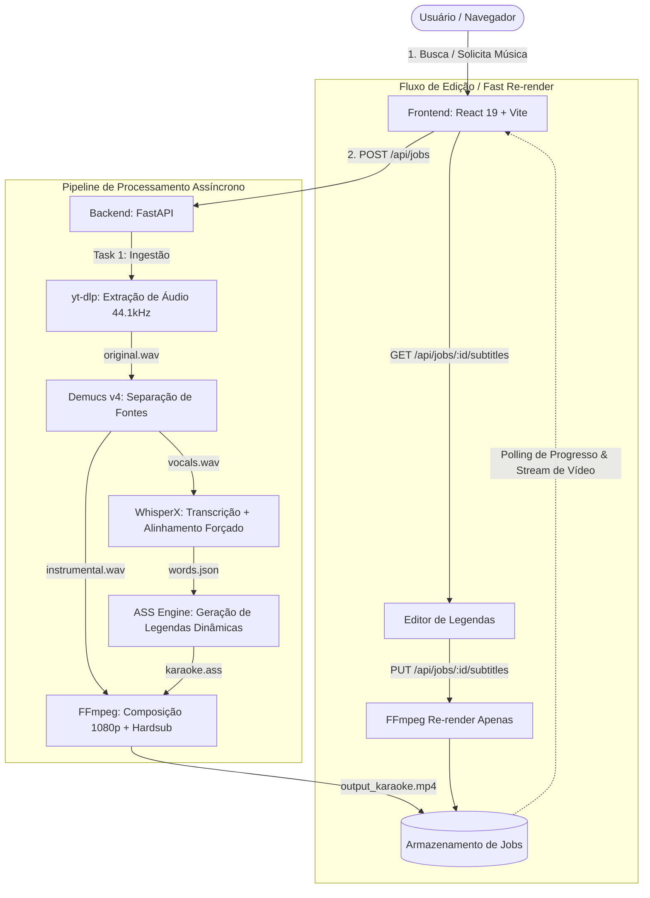

# 🎤 Karaoke AI Studio

<p align="center">
  <strong>Transforme qualquer música em um vídeo profissional de karaokê sincronizado por Inteligência Artificial.</strong>
</p>

<p align="center">
  
  
  
  
  
  
  
  
  <a href="https://www.linkedin.com/in/kaio-ferreira-290716365/" target="_blank">
    
  </a>
</p>

---

## 📌 Sobre o Projeto

O **Karaoke AI Studio** é uma plataforma completa que automatiza a criação de vídeos de karaokê em alta definição (1080p). A partir de uma busca direta ou link do YouTube, o sistema processa a faixa sonora através de uma esteira de modelos de **Inteligência Artificial de ponta** para:

1. **Remover a voz original** com qualidade de estúdio preservando a harmonia instrumental.
2. **Transcrever e sincronizar cada palavra** com precisão de milissegundos via alinhamento forçado de fonemas.
3. **Gerar animações de texto no estilo clássico de karaokê** (preenchimento dinâmico de cor à medida que a sílaba é cantada).
4. **Compor e renderizar o vídeo final** pronto para cantar ou baixar.
5. **Permitir refinamento humano (Human-in-the-loop):** interface visual para ajuste fino de letras, tempos e quebras de versos com **re-renderização ultrarrápida**.

---

## 🚀 Principais Funcionalidades

- 🔍 **Busca Integrada no YouTube:** Pesquise músicas por nome, artista ou cole a URL diretamente na aplicação.
- 🎛️ **Separação de Faixas com IA (Stem Separation):** Utiliza o modelo **Demucs v4 (Hybrid Transformer)** da Meta AI para extrair faixas isoladas de voz e instrumental sem artefatos perceptíveis.
- ⏱️ **Alinhamento Forçado Palavra por Palavra (Word-Level Forced Alignment):** Utiliza **WhisperX** (OpenAI Whisper combinado com modelos acústicos Wav2Vec2) para obter o timestamp exato de início e fim de cada palavra.
- 🎨 **Motor de Legendas Dinâmicas ASS:** Algoritmo que quebra os versos de forma natural baseando-se em respirações/pausas e gera legendas no formato **ASS (Advanced SubStation Alpha)** com efeitos de preenchimento progressivo (`\k` / `\kf`).
- 🎬 **Renderizador FFmpeg Otimizado:** Composição de vídeo 1080p em H.264 + áudio AAC 192 kbps com hardsub de alta fidelidade e monitoramento do progresso de codificação em tempo real.
- ✏️ **Editor Interativo de Legendas:** Corrija palavras erradas da transcrição, adicione ou remova versos e ajuste tempos diretamente no navegador.
- ⚡ **Fast Re-render:** Ajustou uma palavra ou tempo? O sistema re-renderiza o vídeo em poucos segundos usando o instrumental já separado, sem precisar rodar os modelos pesados de IA novamente.
- 📱 **Interface Moderna & Responsiva:** Desenvolvida em React 19 com Tailwind CSS, com acompanhamento de progresso por etapas, feedback de erros e player de vídeo embutido.

---

## 🏗️ Arquitetura do Sistema



---

## 🛠️ Tecnologias Utilizadas

### Backend & Inteligência Artificial
- **[Python 3.12](https://www.python.org/):** Linguagem principal do ecossistema de dados e ML.
- **[FastAPI](https://fastapi.tiangolo.com/):** Framework web assíncrono de alta performance para a API REST.
- **[Demucs (v4 / HTDemucs)](https://github.com/facebookresearch/demucs):** Rede neural de separação de fontes de áudio de alta precisão.
- **[WhisperX](https://github.com/m-bain/whisperX):** Reconhecimento de fala automático (OpenAI Whisper) com alinhamento fonético Wav2Vec2 para timestamps a nível de palavra.
- **[yt-dlp](https://github.com/yt-dlp/yt-dlp):** Extração e download otimizado de faixas de áudio do YouTube.
- **[FFmpeg / FFprobe](https://ffmpeg.org/):** Processamento multimídia, filtragem de legendas ASS e codificação de vídeo MP4 (libx264/aac).
- **[Pydantic v2](https://docs.pydantic.dev/):** Validação estrita de dados e esquemas de configuração.

### Frontend
- **[React 19](https://react.dev/):** Biblioteca para interfaces reativas com os recursos mais recentes da engine.
- **[Vite 8](https://vitejs.dev/):** Ferramenta de build ultrarrápida para desenvolvimento moderno.
- **[Tailwind CSS v4](https://tailwindcss.com/):** Estilização moderna com design system utilitário e responsivo.
- **Player HTML5 nativo com stream direto:** Suporte a reprodução inline sem travamentos e download com um clique.

---

## 📂 Estrutura de Diretórios

```text
karaokeMusics/
├── backend/
│   ├── app/
│   │   ├── api/
│   │   │   ├── routes.py            # Endpoints REST (busca, criação de jobs, status, edição de legendas)
│   │   │   └── schemas.py           # Modelos de validação Pydantic (Request/Response)
│   │   ├── core/
│   │   │   ├── config.py            # Variáveis de ambiente e caminhos de sistema
│   │   │   └── jobs.py              # Gerenciador de estado em memória e fila de jobs
│   │   ├── pipeline/
│   │   │   ├── runner.py            # Orquestrador sequencial das etapas do pipeline
│   │   │   └── tasks/
│   │   │       ├── download.py      # Download e busca via yt-dlp
│   │   │       ├── separate.py      # Separação vocal/instrumental via Demucs
│   │   │       ├── transcribe.py    # Transcrição e alinhamento com WhisperX
│   │   │       ├── subtitles.py     # Gerador de legendas dinâmicas (.ass)
│   │   │       └── render.py        # Composição e codificação de vídeo via FFmpeg
│   │   └── main.py                  # Ponto de entrada FastAPI com middlewares CORS
│   ├── assets/                      # Imagem de fundo padrão para os vídeos gerados
│   ├── requirements.txt             # Dependências da API e utilitários
│   └── requirements-ml.txt          # Dependências de IA (PyTorch, Demucs, WhisperX)
├── frontend/
│   ├── src/
│   │   ├── components/
│   │   │   ├── SearchBar.jsx        # Campo de busca e entrada de links
│   │   │   ├── ResultCard.jsx       # Card com thumbnail, metadados e ação de geração
│   │   │   ├── PipelinePanel.jsx    # Visualizador de progresso por etapa em tempo real
│   │   │   ├── VideoPlayer.jsx      # Player de reprodução e botão de download do vídeo
│   │   │   └── SubtitleEditor.jsx   # Editor interativo de versos, palavras e timestamps
│   │   ├── App.jsx                  # Orquestração do estado e fluxo de tela
│   │   └── index.css                # Estilização global com Tailwind CSS
│   ├── package.json
│   └── vite.config.js
└── README.md
```

---

## ⚙️ Instalação e Execução

### Pré-requisitos
1. **Python 3.12** instalado *(Nota: WhisperX e algumas dependências de PyTorch possuem melhor compatibilidade no 3.12)*.
2. **Node.js 18+** e **npm**.
3. **FFmpeg** instalado e adicionado ao `PATH` do sistema (ou configurado via variável de ambiente).
   - *Windows (via winget):* `winget install Gyan.FFmpeg`
   - *Linux (Ubuntu/Debian):* `sudo apt install ffmpeg`
   - *macOS (via brew):* `brew install ffmpeg`

---

### 1. Configurando o Backend

Abra um terminal na raiz do projeto:

```bash
# 1. Acesse o diretório do backend
cd backend

# 2. Crie o ambiente virtual com Python 3.12
py -3.12 -m venv .venv
# No Linux/macOS: python3.12 -m venv .venv

# 3. Ative o ambiente virtual
# No Windows (PowerShell):
.\.venv\Scripts\Activate.ps1
# No Linux/macOS:
source .venv/bin/activate

# 4. Instale as dependências básicas
pip install -r requirements.txt

# 5. Instale os pacotes de Inteligência Artificial
pip install -r requirements-ml.txt

# 6. Inicie o servidor FastAPI
python -m uvicorn app.main:app --reload --port 8000
```

> **Dica de GPU (Opcional):** Se possuir placa NVIDIA com suporte a CUDA, instale o PyTorch com suporte a CUDA para acelerar drasticamente o Demucs e o WhisperX. Em máquinas sem GPU dedicada, o pipeline roda automaticamente em CPU.

O backend estará ativo em: **`http://localhost:8000`**  
Documentação Swagger interativa: **`http://localhost:8000/docs`**

---

### 2. Configurando o Frontend

Abra um **novo terminal** a partir da raiz do projeto:

```bash
# 1. Acesse o diretório do frontend
cd frontend

# 2. Instale as dependências
npm install

# 3. Inicie o servidor de desenvolvimento
npm run dev
```

Acesse a interface web em seu navegador: **`http://localhost:5173`**

---

## 📡 Visão Geral da API (Endpoints REST)

| Método | Rota | Descrição |
|---|---|---|
| `POST` | `/api/search` | Pesquisa vídeos no YouTube com base em uma query de texto. |
| `POST` | `/api/jobs` | Inicializa o pipeline assíncrono completo de geração de karaokê. |
| `GET` | `/api/jobs/{job_id}` | Consulta o status, etapa atual e percentual de progresso do job. |
| `GET` | `/api/jobs/{job_id}/video` | Retorna o stream do arquivo `.mp4` final ou download direto. |
| `GET` | `/api/jobs/{job_id}/subtitles` | Obtém o conjunto estruturado de versos, palavras e timestamps. |
| `PUT` | `/api/jobs/{job_id}/subtitles` | Salva alterações de legenda e dispara o **Fast Re-render** do vídeo. |
| `GET` | `/api/health` | Health check da aplicação e checagem de binários. |

---

## 💡 Decisões Técnicas e Desafios de Engenharia

- **Fila Sequencial de GPU/CPU (Threading Lock):** A separação de faixas e a transcrição via redes neurais são intensivas em memória VRAM/RAM. Foi implementado um sistema de travamento de execução sequencial no orquestrador (`runner.py`), garantindo que apenas um job pesado seja processado por vez, evitando esgotamento de memória (*Out of Memory*).
- **Divisão Musical de Versos:** Transcrições puras de ASR (Speech-to-Text) não entendem a métrica poética ou métrica musical de uma canção. Foi desenvolvida uma heurística personalizada em `subtitles.py` que calcula pausas entre palavras (gaps de silêncio) e limites de caracteres por linha para compor versos que cabem harmoniosamente na tela.
- **Desacoplamento do Re-render:** Separar os vocais e transcrever leva a maior parte do tempo. Ao salvar a edição de uma letra, o backend pula diretamente para a etapa final do FFmpeg, gerando o novo vídeo em menos de 10 segundos.

---

## 👨‍💻 Autor & Contato

Desenvolvido por **Kaio Ferreira**.

Se tiver dúvidas, sugestões ou quiser discutir sobre Inteligência Artificial, Engenharia de Software ou oportunidades, sinta-se à vontade para se conectar:

- 💼 **LinkedIn:** [linkedin.com/in/kaio-ferreira-290716365](https://www.linkedin.com/in/kaio-ferreira-290716365/)

---

## 📄 Licença

Este projeto é desenvolvido para fins educacionais e de demonstração em portfólio. Consulte as licenças dos modelos de terceiros ([Demucs](https://github.com/facebookresearch/demucs) e [WhisperX](https://github.com/m-bain/whisperX)) para aplicações comerciais.
